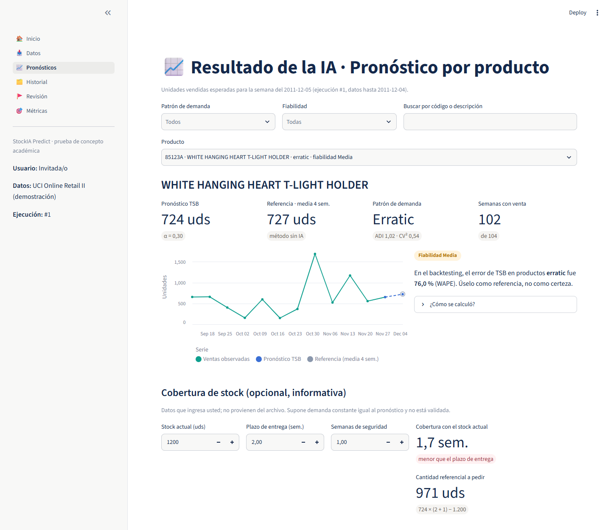
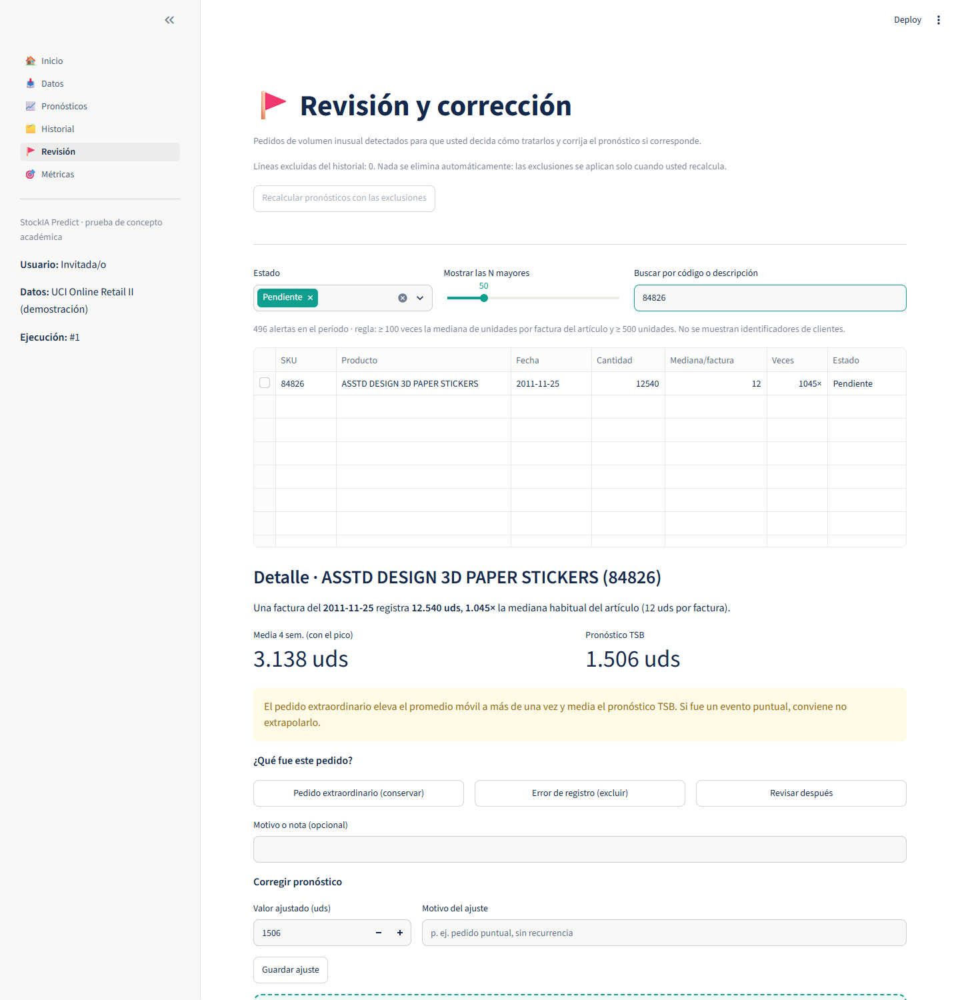
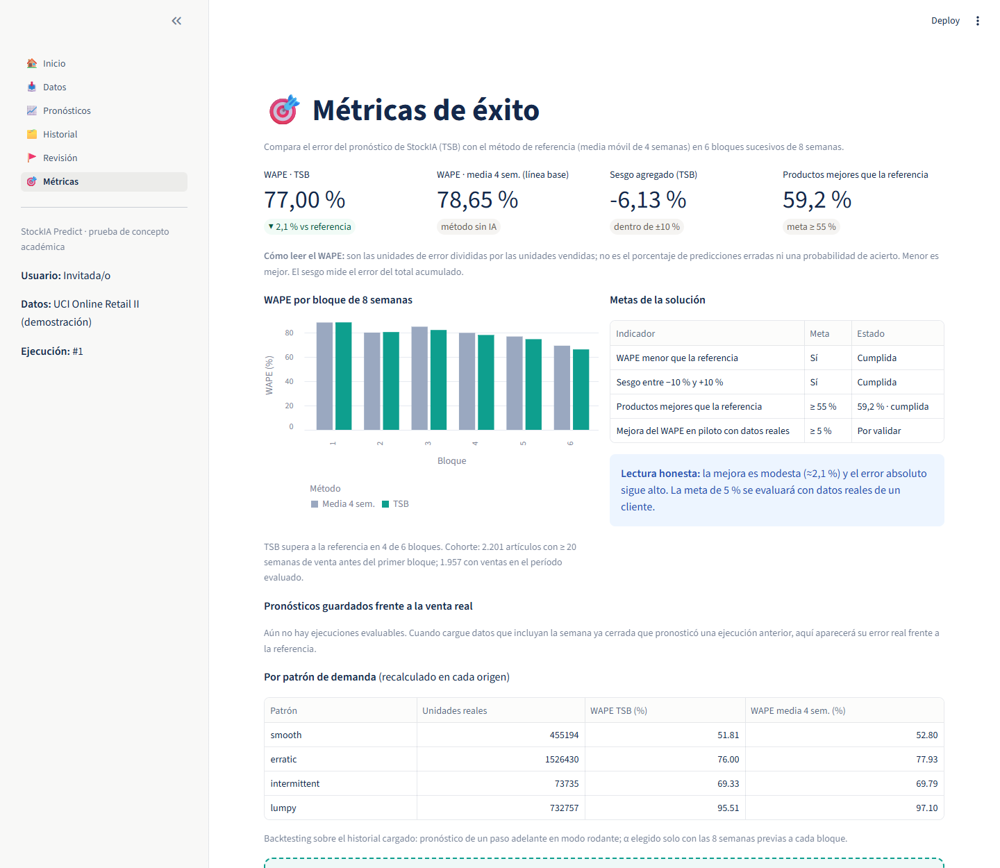
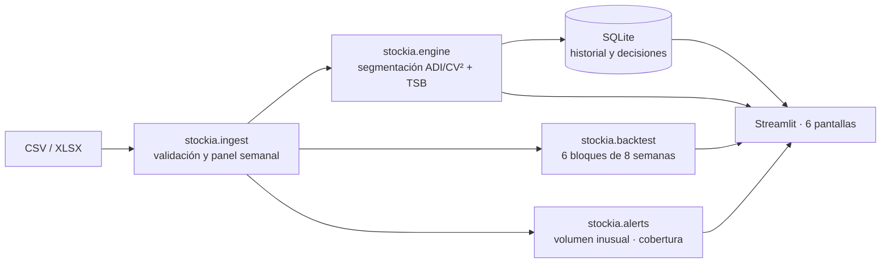

# StockIA Predict


**Pronóstico semanal de ventas por producto y alertas de pedidos inusuales para comercio electrónico.**
Una aplicación web que le dice a una persona de planificación cuánto va a vender cada artículo la semana siguiente, qué tan fiable es ese número y qué pedidos raros conviene revisar antes de confiar en él.

> **TL;DR (EN).** Weekly per-SKU sales forecasting and unusual-order alerts for e-commerce, built on a real anonymised UK retailer dataset (UCI Online Retail II, 1.07 M transactions). An intermittent-demand method (TSB) is evaluated with a leak-free rolling-origin backtest against a naive baseline and ML models. Honest outcome: a modest ≈2 % WAPE improvement over the baseline; supervised ML did not beat it. Includes a Streamlit app, SQLite history, 66 tests, a multi-stage Dockerfile and CI.

<p align="center">
  
</p>

## El problema

Planificar cuántas unidades se venderán de cada artículo es difícil cuando la demanda es irregular. Sobre los datos reales de un comercio electrónico británico (Reino Unido, 2009–2011, 104 semanas completas):

| | |
|---|---|
| **62 %** | de las combinaciones artículo-semana no registra ninguna venta |
| **81 %** | de las unidades pertenece a artículos de demanda irregular (*erratic* o *lumpy*) |
| **78,65 %** | de error (WAPE) del método de referencia, un promedio móvil de 4 semanas |

Además, un solo pedido enorme distorsiona un promedio simple: una factura de 12.540 unidades del artículo 84826 lleva al promedio a proponer 3.138 unidades para la semana siguiente, cuando fue un evento puntual.

## La solución

1. **Carga y valida** un archivo de ventas (CSV/XLSX): duplicados, cancelaciones, cantidades negativas; arma la serie semanal por artículo.
2. **Clasifica** cada artículo según cómo vende (ADI/CV²): *smooth*, *erratic*, *intermittent* o *lumpy*.
3. **Pronostica** la semana siguiente con **TSB** (Teunter–Syntetos–Babai), un método para demanda intermitente que estima por separado la probabilidad de venta y el tamaño de la venta, y los actualiza cada semana. Siempre muestra la referencia de 4 semanas al lado.
4. **Indica la fiabilidad** (alta, media o baja) y recomienda revisión manual cuando el patrón es *lumpy* o hay poca historia.
5. **Alerta** de facturas que superan 100 veces la cantidad habitual del artículo; la persona decide conservarlas o excluirlas y el pronóstico se recalcula.
6. **Registra** cada ejecución en SQLite y, cuando llegan las ventas de la semana siguiente, compara lo pronosticado con lo real.
7. Ofrece una **cobertura de stock informativa** (con el stock y el plazo que ingresa el usuario).

<table>
  <tr>
    <td></td>
    <td></td>
  </tr>
  <tr>
    <td align="center"><sub>Revisión: pedido de 12.540 uds, con y sin el pico</sub></td>
    <td align="center"><sub>Métricas: backtesting en 6 bloques de 8 semanas</sub></td>
  </tr>
</table>

## Resultados

Evaluación **fuera de muestra** con 6 bloques de 8 semanas (2011-01-03 a 2011-11-28) sobre 2.201 artículos. El método y su parámetro se eligen solo con las 8 semanas anteriores a cada bloque.

| Estrategia | WAPE | Sesgo |
|---|---:|---:|
| Híbrido por segmentos | 75,93 % | −13,45 % |
| **TSB (solución elegida)** | **77,00 %** | −6,13 % |
| HGB Hurdle Poisson (Machine Learning) | 78,41 % | −1,10 % |
| **Promedio móvil 4 semanas (línea base)** | **78,65 %** | −4,77 % |
| LightGBM Poisson (Machine Learning) | 79,88 % | −0,25 % |

- TSB reduce el error ≈ **2,1 %** frente a la línea base; la supera en 4 de 6 bloques y en el 59 % de los productos.
- **La mejora es modesta** y el error absoluto sigue alto: es una prueba de concepto, no un sistema para automatizar compras.
- TSB es un método **estadístico**, no Machine Learning supervisado; los modelos ML evaluados no lo superaron claramente.
- **Cómo leer el WAPE:** son las unidades de error divididas por las unidades vendidas. No es el porcentaje de predicciones erradas ni una probabilidad de acierto: por producto y semana el pronóstico es aproximado, mientras que en el total acumulado el sesgo es de solo −6,13 %.

Tablas completas (por bloque, patrón y producto) en [`docs/RESULTADOS.md`](docs/RESULTADOS.md).

## Qué demuestra este proyecto

- **Evaluación temporal rigurosa.** Backtesting rodante con selección anidada de parámetros; hay pruebas que verifican que cambiar el «futuro» de una serie no altera los pronósticos pasados (sin fuga de información).
- **Auditoría de datos que encontró un error propio.** Al contrastar con el Excel original se detectó que el panel derivado contaba dos veces ~163 mil unidades (las dos hojas del libro se solapan del 1 al 9 de diciembre de 2010). Se corrigió, se regeneraron los resultados y quedó una prueba de regresión. Detalle en [`docs/METODOLOGIA.md`](docs/METODOLOGIA.md).
- **Honestidad sobre los resultados.** Se reporta lo que no funcionó (el ML no ganó), el tamaño real de la mejora y los límites de cada afirmación.
- **Ingeniería reproducible.** La lógica (`stockia/`) está separada de la interfaz y se prueba aparte; 66 pruebas (incluida cada pantalla con `streamlit.testing`); Dockerfile multietapa sin permisos de administrador; integración continua que ejecuta pruebas y construye las imágenes. Subir el Excel original reproduce exactamente el panel de demostración.

## Arquitectura



## Cómo ejecutarlo

**Con Python 3.13 (la versión con la que se probó):**

```bash
python -m venv .venv
.venv/Scripts/Activate.ps1          # Linux/macOS: source .venv/bin/activate
pip install -r requirements-dev.txt
streamlit run app/streamlit_app.py  # http://localhost:8501  (botón «datos de demostración»)
python -m pytest                    # 66 pruebas, ~20 s
python scripts/05_backtesting_model_selection.py   # reproduce el resultado oficial (~1 min)
```

**Con Docker:**

```bash
docker build --target app -t stockia-app . && docker run --rm -p 8501:8501 -v stockia-data:/app/data/app stockia-app
docker build --target test -t stockia-predict:test . && docker run --rm stockia-predict:test
```

El Excel original de UCI no se versiona (descárguelo en `data/raw/` para regenerar el panel con `scripts/01_audit_dataset.py` o los datos de demostración con `scripts/06_build_demo_assets.py`). Las capturas de este README se generan con `scripts/07_capture_screenshots.py` (requiere `pip install playwright` y Edge o Chrome instalado).

## Estructura del repositorio

```text
├── stockia/            # Lógica: pronóstico, ingesta, backtest, alertas, SQLite (sin interfaz)
├── app/                # Aplicación Streamlit (6 pantallas)
├── tests/              # 66 pruebas (lógica, interfaz y reproducción del resultado oficial)
├── scripts/            # 01 auditoría · 05 backtesting · 06 datos demo · 07 capturas · 02–04 etapa exploratoria
├── data/processed/     # Panel semanal derivado (CC BY 4.0)
├── data/demo/          # Descripciones y alertas de demostración (sin identificadores de clientes ni facturas)
├── reports/            # backtesting/ (oficial) · eda/ (auditoría) · archive_v0.3/ (exploratorio)
├── docs/               # RESULTADOS · METODOLOGIA · entrega/ (preinforme, mockups, presentación) · business/ · archive/
├── infra/terraform/    # AWS (ECS Fargate, ALB, ECR): escrito y validado, NO desplegado
├── Dockerfile · .github/workflows/ci.yml · requirements*.txt
└── DATASET_CITATION.md · CHANGELOG.md
```

## Alcance y límites

- Pronostica **ventas observadas**. El dataset no incluye inventario, ventas perdidas, órdenes de compra ni plazos de proveedores, así que **no se afirma** reducción de quiebres ni ahorro económico, y no se generan órdenes de compra. La cobertura de stock es informativa y no está validada.
- Una semana sin ventas se registra como 0; no equivale a disponibilidad de inventario.
- No hay etiqueta de mayorista por cliente: una factura grande no prueba que el comprador lo sea. `Customer ID` no se usa en el modelo ni aparece en pantallas, exportaciones o datos de demostración.
- Datos históricos (2009–2011) del Reino Unido; no extrapolar sin validar con datos actuales.
- El acceso de la app es simulado (sin autenticación real).

## Siguientes pasos

- Validar la propuesta con entrevistas a potenciales usuarios (el protocolo está en [`docs/validation/`](docs/validation/)) y la meta de mejora ≥ 5 % con datos reales de un cliente.
- Infraestructura en AWS: ya está escrita en [`infra/terraform/`](infra/terraform/) (ECS Fargate + balanceador + ECR); falta desplegarla, y por ahora solo se comprobó que valida, sin `plan` ni `apply`.
- Con inventario y plazos reales: validar la reposición y medir quiebres y nivel de servicio.

## Autoría, atribución y licencia

Proyecto académico de la asignatura TI2082 *Aplicaciones de Inteligencia Artificial*, de **Pamela Salas** y **Pablo Jara**. Documentos de la entrega (preinforme, mockups, presentación) en [`docs/entrega/`](docs/entrega/).

Datos: Chen, D. (2012). *Online Retail II*. UCI Machine Learning Repository. DOI [10.24432/C5CG6D](https://doi.org/10.24432/C5CG6D). Licencia del dataset y del panel derivado: CC BY 4.0 (ver [`DATASET_CITATION.md`](DATASET_CITATION.md)). Método: Teunter, Syntetos y Babai (2011), *European Journal of Operational Research* 214(3). El código no tiene licencia de reutilización independiente hasta que se elija una.
